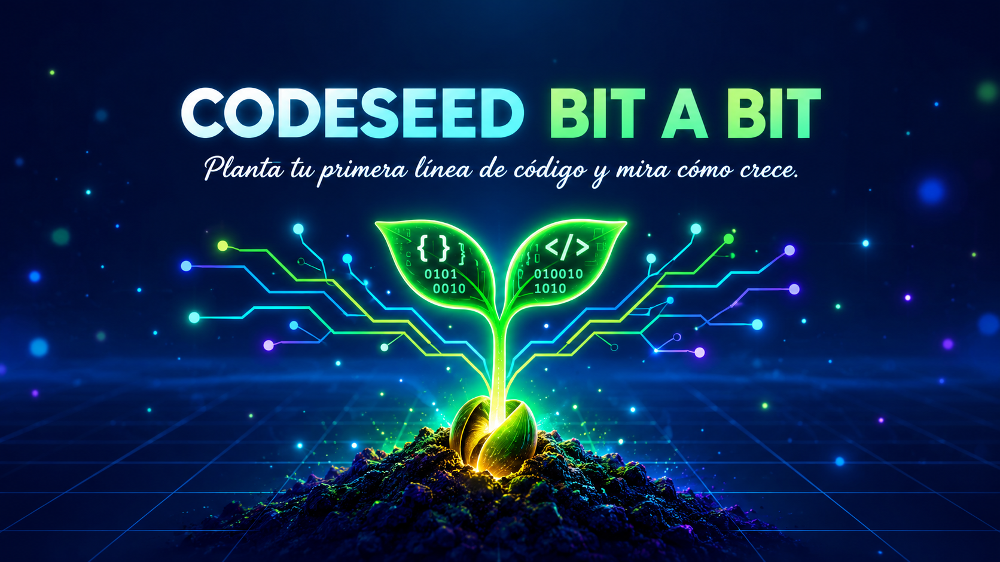
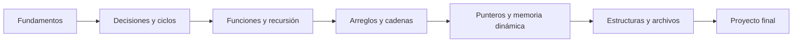

<div align="center">



# 🌱 Codeseed Bit a Bit

### _“Planta tu primera línea de código y mira cómo crece.”_

Aprende a programar desde cero, construyendo y compartiendo con la comunidad


[Ver el roadmap](#-roadmap) · [Cómo contribuir](#-cómo-contribuir) · [Reportar un problema](../../issues) · [Proponer una idea](../../discussions)

</div>

---

## 📖 Tabla de contenidos

- [Acerca del proyecto](#-acerca-del-proyecto)
- [Filosofía](#-filosofía)
- [A quién va dirigido](#-a-quién-va-dirigido)
- [Contenido del repositorio](#-contenido-del-repositorio)
- [Rutas de aprendizaje](#-rutas-de-aprendizaje)
- [Proyectos personales de la comunidad](#-proyectos-personales-de-la-comunidad)
- [Primeros pasos](#-primeros-pasos)
- [Estructura de carpetas](#-estructura-de-carpetas)
- [Cómo está organizado cada módulo](#-cómo-está-organizado-cada-módulo)
- [Roadmap](#-roadmap)
- [Cómo contribuir](#-cómo-contribuir)
- [Código de conducta](#-código-de-conducta)
- [Licencia](#-licencia)
- [Contacto y comunidad](#-contacto-y-comunidad)
- [Agradecimientos](#-agradecimientos)

---

## 🎯 Acerca del proyecto

**Codeseed Bit a Bit** es un repositorio abierto donde se desarrollan **proyectos educativos para aprender lenguajes de programación desde cero**, pensados para quienes aman programar y disfrutan entendiendo cómo funcionan las cosas por dentro.

Además del material de aprendizaje, el repositorio reúne **proyectos personales** creados con la intención de **compartirlos con la comunidad**: herramientas, juegos, experimentos y utilidades que sirven tanto de inspiración como de ejemplo real de código.

> 🌱 **¿Por qué «Codeseed»?** Porque todo programador empieza con una semilla: una primera línea de código. Con práctica constante, **bit a bit**, esa semilla crece hasta convertirse en proyectos completos que también puedes compartir.

> 💡 **La idea central:** se aprende mejor construyendo. Cada concepto viene acompañado de un proyecto, un ejercicio o un programa que puedes ejecutar, romper y mejorar.

### ✨ Características principales

- 📚 **Aprendizaje desde cero:** sin requisitos previos, avanzando paso a paso.
- 🧩 **Proyectos prácticos** en lugar de teoría aislada.
- 🌍 **Varios lenguajes:** cada uno con su propia ruta de aprendizaje.
- 🛠️ **Proyectos personales abiertos** para estudiar, usar y mejorar.
- 🤝 **Hecho para colaborar:** cualquiera puede aportar ejercicios, correcciones o proyectos nuevos.
- 🆓 **100 % gratuito y de código abierto.**

---

## 🧭 Filosofía

1. **Entender antes que memorizar.** Lo importante es saber _por qué_ funciona algo.
2. **Código que se ejecuta.** Todo ejemplo debe compilar o correr sin errores.
3. **Equivocarse es parte del proceso.** Los errores comunes se documentan, no se esconden.
4. **Compartir multiplica.** Lo que aprendes hoy puede ayudar a alguien mañana.
5. **Progreso gradual.** De lo simple a lo complejo, sin saltos bruscos.

---

## 👥 A quién va dirigido

| Perfil                                       | Qué encontrarás                                                    |
| :------------------------------------------- | :----------------------------------------------------------------- |
| 🌱 **Principiantes absolutos**               | Rutas desde cero, con explicaciones claras y ejercicios básicos    |
| 🎓 **Estudiantes**                           | Material de apoyo y ejercicios con distintos niveles de dificultad |
| 🧑‍💻 **Autodidactas**                          | Proyectos completos para practicar y ampliar portafolio            |
| 🔁 **Programadores que cambian de lenguaje** | Comparaciones y equivalencias entre lenguajes                      |
| 💞 **Amantes de la programación**            | Experimentos, retos y proyectos personales para inspirarse         |

---

## 📦 Contenido del repositorio

### 🎓 Proyectos educativos

Cursos y cuadernos de práctica organizados por lenguaje. Cada uno incluye teoría breve, ejemplos ejecutables, ejercicios y un proyecto final.

### 🧪 Proyectos personales

Desarrollos propios publicados para la comunidad: pueden usarse, estudiarse, modificarse y mejorarse.

### 📝 Recursos de apoyo

Guías de referencia, hojas de trucos (_cheat sheets_), plantillas y enlaces útiles.

---

## 🗺️ Rutas de aprendizaje

> Marca con ✅ lo que ya esté disponible y con 🚧 lo que esté en construcción. Ajusta la lista a tus lenguajes.

| Lenguaje            | Nivel                     |   Estado    | Carpeta                                             |
| :------------------ | :------------------------ | :---------: | :-------------------------------------------------- |
| **C**               | Principiante → Intermedio |     ✅      | [`/educativos/c`](./educativos/c)                   |
| **Python**          | Principiante              |     🚧      | [`/educativos/python`](./educativos/python)         |
| **JavaScript**      | Principiante              |     🚧      | [`/educativos/javascript`](./educativos/javascript) |
| **[Otro lenguaje]** | —                         | 📅 Planeado | —                                                   |

### Ejemplo de ruta: lenguaje C



| Módulo                    | Temas                                          | Tipo de práctica       |
| :------------------------ | :--------------------------------------------- | :--------------------- |
| 1. Fundamentos            | Variables, tipos de datos, `printf`, `scanf`   | Ejercicios cortos      |
| 2. Control de flujo       | `if`, `switch`, `for`, `while`                 | Mini programas         |
| 3. Funciones              | Parámetros, retorno, recursión, ámbito         | Retos de lógica        |
| 4. Arreglos y cadenas     | Vectores, matrices, `string.h`, `ctype.h`      | Procesamiento de texto |
| 5. Punteros               | Direcciones, `malloc`, `realloc`, `free`       | Estructuras dinámicas  |
| 6. Estructuras y archivos | `struct`, `enum`, archivos de texto y binarios | Agenda de contactos    |
| 7. Proyecto final         | Integración de todo lo aprendido               | Proyecto completo      |

---

## 🌟 Proyectos personales de la comunidad

Proyectos creados para compartir. ¡Tú también puedes sumar el tuyo!

| Proyecto       | Descripción                     | Lenguaje   | Enlace                         |
| :------------- | :------------------------------ | :--------- | :----------------------------- |
| **[Nombre 1]** | [Breve descripción de qué hace] | C          | [Ver](./personales/proyecto-1) |
| **[Nombre 2]** | [Breve descripción de qué hace] | Python     | [Ver](./personales/proyecto-2) |
| **[Nombre 3]** | [Breve descripción de qué hace] | JavaScript | [Ver](./personales/proyecto-3) |

> 📌 ¿Quieres añadir un proyecto? Consulta la sección [Cómo contribuir](#-cómo-contribuir).

---

## 🏁 Primeros pasos

### Requisitos previos

No necesitas experiencia previa. Solo necesitas:

- Un ordenador con Windows, macOS o Linux
- Un editor de código ([VS Code](https://code.visualstudio.com/) es una buena opción gratuita)
- [Git](https://git-scm.com/) para clonar el repositorio
- El compilador o intérprete del lenguaje que quieras estudiar:

| Lenguaje   | Qué instalar                                                      |
| :--------- | :---------------------------------------------------------------- |
| C          | `gcc` (en Windows: [MinGW-w64](https://www.mingw-w64.org/) o WSL) |
| Python     | [Python 3.10+](https://www.python.org/downloads/)                 |
| JavaScript | [Node.js](https://nodejs.org/)                                    |

### Instalación

```bash
# 1. Clona el repositorio
git clone https://github.com/maytechnology73/codeseed-bit-a-bit.git

# 2. Entra en la carpeta
cd codeseed-bit-a-bit

# 3. Elige una ruta de aprendizaje
cd educativos/c
```

### Tu primer programa (ejemplo en C)

```c
#include <stdio.h>

int main(void) {
    printf("Hola, comunidad!\n");
    return 0;
}
```

Compílalo y ejecútalo:

```bash
gcc -Wall -Wextra -std=c11 hola.c -o hola
./hola
```

> 💡 **Consejo:** compila siempre con `-Wall -Wextra`. Los avisos del compilador son tus mejores maestros.

---

## 📁 Estructura de carpetas

```text
.
├── educativos/
│   ├── c/
│   │   ├── 01-fundamentos/
│   │   ├── 02-control-de-flujo/
│   │   ├── 03-funciones/
│   │   ├── ...
│   │   └── proyecto-final/
│   ├── python/
│   └── javascript/
├── personales/
│   ├── proyecto-1/
│   ├── proyecto-2/
│   └── proyecto-3/
├── recursos/
│   ├── hojas-de-trucos/
│   ├── plantillas/
│   └── enlaces-utiles.md
├── .github/
│   ├── ISSUE_TEMPLATE/
│   └── PULL_REQUEST_TEMPLATE.md
├── CONTRIBUTING.md
├── CODE_OF_CONDUCT.md
├── LICENSE
└── README.md
```

---

## 🧱 Cómo está organizado cada módulo

Todos los módulos siguen la misma estructura para que siempre sepas dónde buscar:

```text
01-fundamentos/
├── README.md        ← Explicación del tema
├── ejemplos/        ← Programas listos para ejecutar
├── ejercicios/      ← Enunciados por nivel
├── soluciones/      ← Soluciones (¡inténtalo antes de mirar!)
└── proyecto/        ← Mini proyecto que integra el módulo
```

### Niveles de ejercicios

| Nivel             | Significado                          |
| :---------------- | :----------------------------------- |
| 🟢 **Básico**     | Aplicar un concepto recién aprendido |
| 🟡 **Intermedio** | Combinar varios conceptos            |
| 🔴 **Avanzado**   | Reto que exige pensar y diseñar      |

### Cómo estudiar con este repositorio

1. **Lee** el `README.md` del módulo.
2. **Ejecuta** los ejemplos y cámbiales valores.
3. **Resuelve** los ejercicios _antes_ de mirar las soluciones.
4. **Construye** el proyecto del módulo.
5. **Comparte** tu versión o tus dudas en las [Discussions](../../discussions).

---

## 🛣️ Roadmap

- [x] Estructura base del repositorio
- [x] Ruta de aprendizaje de C
- [ ] Ruta de aprendizaje de Python
- [ ] Ruta de aprendizaje de JavaScript
- [ ] Sección de retos semanales
- [ ] Proyectos personales documentados paso a paso
- [ ] Traducción de contenidos a otros idiomas
- [ ] Hojas de trucos descargables en PDF
- [ ] Sistema de insignias de progreso

¿Tienes una idea? Abre un [issue](../../issues) o inicia una [discusión](../../discussions).

---

## 🤝 Cómo contribuir

¡Las contribuciones son lo que hace grande a una comunidad! Todo aporte es bienvenido: desde corregir una errata hasta añadir un proyecto completo.

### Formas de colaborar

- 🐛 Reportar errores en ejemplos o explicaciones
- ✍️ Mejorar o aclarar la redacción
- 🧩 Añadir ejercicios o soluciones alternativas
- 🌟 Compartir tu propio proyecto personal
- 🌐 Traducir contenidos
- 💡 Proponer nuevos lenguajes o módulos

### Flujo de trabajo

```bash
# 1. Haz un fork del repositorio

# 2. Crea una rama para tu aporte
git checkout -b feature/mi-aporte

# 3. Haz tus cambios y confírmalos
git add .
git commit -m "feat: añade ejercicio de punteros"

# 4. Sube la rama
git push origin feature/mi-aporte

# 5. Abre un Pull Request
```

### Convención de mensajes de commit

| Prefijo     | Uso                            |
| :---------- | :----------------------------- |
| `feat:`     | Nuevo contenido o proyecto     |
| `fix:`      | Corrección de un error         |
| `docs:`     | Cambios en documentación       |
| `style:`    | Formato, sin cambios de lógica |
| `refactor:` | Reorganización de código       |
| `test:`     | Añadir o corregir pruebas      |

### Para añadir un proyecto personal

1. Crea una carpeta dentro de `/personales/` con el nombre de tu proyecto.
2. Incluye un `README.md` propio con: descripción, cómo ejecutarlo y qué se puede aprender de él.
3. Asegúrate de que compila o se ejecuta sin errores.
4. Añádelo a la tabla de [proyectos de la comunidad](#-proyectos-personales-de-la-comunidad).
5. Abre tu Pull Request.

### Checklist antes de enviar un Pull Request

- [ ] El código compila o se ejecuta sin errores
- [ ] Sigue la estructura de carpetas del proyecto
- [ ] Incluye comentarios donde la lógica no sea evidente
- [ ] No contiene datos personales ni contraseñas
- [ ] La documentación está actualizada

Para más detalles, lee [`CONTRIBUTING.md`](./CONTRIBUTING.md).

---

## 📜 Código de conducta

Queremos una comunidad **amable, respetuosa y acogedora**, especialmente con quienes están empezando. Preguntar no es de tontos: todos fuimos principiantes.

- Sé respetuoso con las dudas y los errores ajenos.
- Critica el código, nunca a la persona.
- No se tolera el acoso ni la discriminación de ningún tipo.

Consulta el [`CODE_OF_CONDUCT.md`](./CODE_OF_CONDUCT.md) completo.

---

## 📄 Licencia

Este proyecto se distribuye bajo la licencia **MIT**. Puedes usar, copiar, modificar y compartir el contenido libremente, manteniendo el aviso de autoría.

Consulta el archivo [`LICENSE`](./LICENSE) para más información.

---

## 💬 Contacto y comunidad

| Canal               | Enlace                                                 |
| :------------------ | :----------------------------------------------------- |
| 👤 Autor            | [@maytechnology73](https://github.com/maytechnology73) |
| 📧 Correo           | maytechnology73@gmail.com                              |
| 💬 Discusiones      | [GitHub Discussions](../../discussions)                |
| 🐛 Incidencias      | [GitHub Issues](../../issues)                          |
| 🌐 Sitio web / blog | [tu-sitio.com](https://tu-sitio.com)                   |

---

## 🙏 Agradecimientos

- A todas las personas que contribuyen con ideas, correcciones y proyectos.
- A la comunidad de software libre, por demostrar que compartir conocimiento nos hace crecer a todos.
- A los recursos que sirven de inspiración y referencia:
  - [Best-README-Template](https://github.com/othneildrew/Best-README-Template)
  - [Shields.io](https://shields.io)
  - [Markdown Guide](https://www.markdownguide.org/)
  - [Choose a License](https://choosealicense.com/)

---

<div align="center">

### ⭐ Si este proyecto te ayuda, dale una estrella y compártelo

**Aprender es mejor en comunidad.**

[⬆ Volver arriba](#-codeseed-bit-a-bit)

</div>
